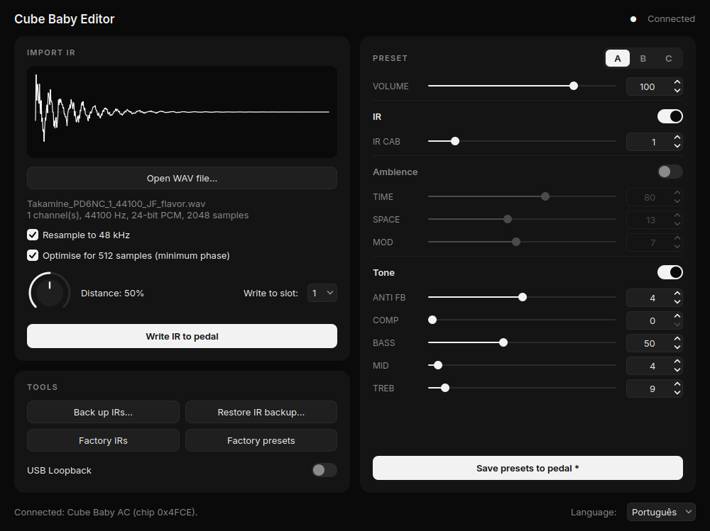

# Cube Baby Editor 🎸🐧

**Native Linux editor for the Cube Baby AC pedal (Cuvave / M-VAVE)** — edit presets, import IRs and
use the pedal as an audio interface, **no Windows and no Wine required**.

🇧🇷 [Leia em português](README.pt-BR.md)



---

> ## ⚠️ Please read first
>
> **I am not a programmer and I am not an audio technician** — I know very little about this field.
> **All the code, the protocol reverse engineering, the tests, the packaging and this documentation
> were generated by Claude** (Anthropic's AI), using Claude Code, following my instructions and the
> tests I ran with my own pedal.
>
> I'm publishing it because it works for me and it may help other Linux users who, like me, owned a
> pedal that "only worked on Windows". I can't offer advanced technical support.

> **Legal notice:** independent project made for **interoperability** (making your own device work
> on your own system). **Not affiliated with, endorsed or supported by Cuvave / M-VAVE.** Cube Baby,
> Cuvave and M-VAVE are trademarks of their respective owners. No Cuvave files, code or firmware are
> distributed here. **Use at your own risk** — the software is provided "as is", without warranty
> (see the [license](LICENSE)).

---

## Contents

- [What it is](#what-it-is)
- [✨ What we did better than the original software](#-what-we-did-better-than-the-original-software)
- [Features](#features)
- [Compatibility](#compatibility)
- [Quick install (.deb)](#quick-install-deb)
- [First use](#first-use)
- [Using the pedal as an audio interface](#using-the-pedal-as-an-audio-interface)
- [Guide to every pedal function](#guide-to-every-pedal-function)
- [Importing IRs](#importing-irs)
- [Backups and factory IRs](#backups-and-factory-irs)
- [What about the firmware?](#what-about-the-firmware)
- [Troubleshooting](#troubleshooting)
- [Install from source (other distributions)](#install-from-source-other-distributions)
- [Let another AI install it](#let-another-ai-install-it)
- [How it was made](#how-it-was-made)
- [Contributing](#contributing)
- [License](#license)

---

## What it is

The Cube Baby AC is a small effects processor for acoustic guitar. Its vendor editor, **CubeSuite**,
only exists for Windows. On Linux it can run under Wine, but only as a workaround.

**Cube Baby Editor** replaces CubeSuite with a **native Linux program**, installed like any other
(`.deb`), that talks to the pedal directly over USB.

## ✨ What we did better than the original software

We didn't just want to "port" CubeSuite to Linux. While studying how it works internally we found
limitations and fixed several of them. Everything below was verified by analysing CubeSuite's code
or by measurement:

| | CubeSuite (vendor) | Cube Baby Editor (this project) |
|---|---|---|
| **Platform** | Windows only (on Linux, only as a Wine workaround) | **Native Linux**, installs as a `.deb` and updates with the system |
| **44.1 kHz IRs** (the most common format) | Written without conversion: the IR becomes ~9% shorter and the tone shifts (~1.5 semitones up) | **Resampled to 48 kHz**: the IR sounds as recorded |
| **IRs longer than the pedal's limit** (512 samples) | Hard truncation | **Minimum-phase optimisation** before truncating: **~14% less tonal error and ~32% less in the low end** (measured on a real acoustic IR) |
| **How much of the IR fits** | Not shown | **Shows** the stored duration and the % of IR energy kept, with a preview of the processed waveform |
| **32-bit WAV files** | Mono (float or PCM): only half of each sample is read, as if it were 16-bit, so the IR comes out wrong. Stereo PCM: nothing is read (silent IR) | **Read correctly**, as are PCM 16/24-bit and the *extensible* format |
| **Backup before writing an IR** | None | **Automatic**, always, before any replacement |
| **Initial pedal backup** | Doesn't exist | **Automatic on first connection** (8 IRs + 3 presets) |
| **"Factory IRs"** | Erases your custom IRs without keeping a copy | **Takes a full backup first** so you can undo it |
| **Restoring IRs** | Doesn't exist | Restores **all of them** or **a single slot** |
| **Firmware protection** | No safeguard in the editor | **Safety lock:** refuses to erase/write any memory area outside the IRs |
| **USB Loopback** | Re-sends the state when the editor opens | **Reads the pedal's real state** and shows it |
| **Internet** | Downloads firmware over unencrypted HTTP, straight from an IP address | **Never goes online** |
| **Code and documentation** | Closed | **Open source (MIT)**, documented protocol and automated tests checked against real pedal messages |

## Features

| Feature | Status |
|---|---|
| Read presets A, B and C from the pedal | ✅ |
| Change every control **live** (you hear it immediately) | ✅ |
| Turn each section on/off (IR, Ambience, Tone) | ✅ |
| Interface in **English and Portuguese** (switch any time, at the bottom right) | ✅ |
| Minimalist black-and-white look; the title bar follows the system theme | ✅ |
| Save presets to the pedal (with read-back verification) | ✅ |
| Reset presets to factory values | ✅ |
| USB Loopback (on/off, shows the real state) | ✅ |
| Import an IR from a WAV file (16/24/32-bit, mono or stereo) | ✅ |
| **Resample the IR to 48 kHz** automatically | ✅ (CubeSuite doesn't) |
| **Optimise the IR for the 512-sample limit** (minimum phase) | ✅ (CubeSuite doesn't) |
| Back up and restore IRs (all of them or a single slot) | ✅ (CubeSuite doesn't) |
| Automatic backup on first connection | ✅ (CubeSuite doesn't) |
| Restore factory IRs | ✅ (needs a file from CubeSuite — [see here](#backups-and-factory-irs)) |
| Use as an audio interface (record/play) | ✅ works without any program |
| Firmware update | ❌ on purpose — [see why](#what-about-the-firmware) |

**Safety:** the pedal's firmware lives in the same memory as the IRs. The program **refuses to erase
or write anything outside the IR area** and always backs up an IR before replacing it.

## Compatibility

**Pedal:** only the **Cube Baby AC** has been tested (USB ID `301a:5555`). If another model is
connected, the program says so and does nothing.

**Systems (.deb package):**

| System | Status |
|---|---|
| Zorin OS 18 | ✅ tested |
| Ubuntu 24.04 or newer, Linux Mint 22, Pop!_OS 24.04 | ✅ should work (same base) |
| Debian 12 or newer | ✅ should work |
| Ubuntu 22.04 / Mint 21 and older | ❌ PyQt6 isn't in their repositories — [install from source](#install-from-source-other-distributions) |
| Fedora, Arch and others | ⚙️ [from source](#install-from-source-other-distributions) (untested) |

## Quick install (.deb)

1. Download `cubebaby-editor_X.Y.Z_all.deb` from this repository's
   [**Releases**](../../releases/latest) page.
2. Open a terminal in the folder where it was saved (usually `Downloads`) and run:

   ```bash
   cd ~/Downloads
   sudo apt update
   sudo apt install ./cubebaby-editor_*_all.deb
   ```

   > The leading `./` matters: it tells `apt` this is a local file. `apt` installs everything the
   > program needs by itself (PyQt6, python3-rtmidi, numpy, scipy). A warning like *"Download is
   > performed unsandboxed as root"* is normal and can be ignored.

3. Open **Cube Baby Editor** from your applications menu (or type `cubebaby-editor` in a terminal).

**That's it.** No driver is needed: Linux already recognises the pedal.

**Update:** download the new `.deb` and repeat step 2.
**Uninstall:** `sudo apt remove cubebaby-editor`
(your backups in `~/.local/share/cubebaby-editor/` are kept).

## First use

1. Switch the pedal on and connect it to the computer with the USB cable.
2. **Close CubeSuite/Wine** if it is open — two programs talking to the pedal at once get in each
   other's way.
3. Open Cube Baby Editor. The bottom bar should say `Connected: Cube Baby AC (chip 0x4FCE)`.
4. On the **first connection**, the program automatically **backs up the 8 IRs and 3 presets**
   currently on the pedal (about 15 seconds). If you never changed the IRs, this backup **is the
   factory IR set** — keep it safe.

Backups are stored in `~/.local/share/cubebaby-editor/backups/` (a hidden folder: press `Ctrl+H` in
the file manager to see it).

## Using the pedal as an audio interface

This **doesn't depend on this program**: the pedal follows the *USB Audio Class* standard and Linux
recognises it on its own.

- It shows up as **"USB2.0 Device"** in the sound settings.
- **Input (record):** 1 channel, 48 kHz, 16-bit. **Output:** 2 channels, 48 kHz, 16-bit.
- Pick **"USB2.0 Device"** as the input in Audacity, Reaper, Ardour, OBS, etc.

Quick terminal test (play something while it records for 5 seconds):

```bash
arecord -l                      # find the card number of "USB2.0 Device" (e.g. card 2)
arecord -D plughw:2,0 -f S16_LE -r 48000 -c 1 -d 5 test.wav && aplay test.wav
```

## Guide to every pedal function

> There is no detailed official manual for the Cube Baby AC available. What follows combines what
> CubeSuite's code reveals with the vendor's product description. **Inferences are marked as such.**
> When in doubt, change one control at a time and listen.

### Presets

- **A, B and C** — three "memories" holding every setting. You switch between them on the pedal
  itself. In the program, the A/B/C selector only chooses **which one** you're editing.
- **Live vs. saved** — changing a control changes the sound **immediately**, but it is only stored
  permanently when you click **"Save presets to pedal"** (the button shows a `*` when there are
  unsaved changes). Unsaved changes are lost when the pedal is switched off.

### Controls

| Control | Range | What it does |
|---|---|---|
| **VOLUME** | 0–127 | Overall preset volume. |
| **IR CAB** | 0–8 | Which of the 8 IRs (acoustic body simulations) the preset uses. Value N uses slot N. *Inferred:* 0 probably means no IR. |
| **TIME** | 0–127 | *Inferred:* time-based effect — delay (echo). |
| **SPACE** | 0–31 | *Inferred:* ambience — reverb. |
| **MOD** | 0–15 | *Inferred:* modulation — chorus/tremolo. |
| **ANTI FB** | 0–8 | **Anti-feedback.** The vendor describes "up to 8 automatic notch filters" against live feedback; the number appears to be how many filters are active. Use more when playing loud, close to the speaker. |
| **COMP** | 0–8 | **Compressor.** Evens out loud and soft notes; higher = more even (and less dynamic). |
| **BASS / MID / TREB** | 0–127 | 3-band EQ: lows, mids and highs. |

### Section switches

The switches next to each section name turn the whole section on/off without losing its settings:

- **IR** → controls IR CAB
- **Ambience** → TIME, SPACE and MOD
- **Tone** → ANTI FB, COMP, BASS, MID and TREB

### Tools

- **USB Loopback** — when the pedal is connected to the PC as an audio interface, loopback **mixes
  whatever the computer is playing into the signal the pedal records.**
  - **On:** great for **live streaming** — play along with a backing track and send both to OBS,
    Zoom, etc.
  - **Off:** use it when **recording in an audio program** (Reaper, Audacity…). With it on, the
    program would record what it is playing back (echo / doubled tracks).
- **Factory presets** — resets A, B and C to their original values. IRs are not touched.
- **Factory IRs**, **Back up IRs** and **Restore IR backup** — see
  [Backups and factory IRs](#backups-and-factory-irs).

## Importing IRs

An **IR** (*impulse response*) is a sonic "fingerprint" of a guitar body or cabinet. The pedal has
**8 slots** for IRs, selected with the **IR CAB** control.

1. Click **"Open WAV file…"** and pick the IR.
2. Check the information and the waveform preview.
3. Set **Distance** and choose the slot in **"Write to slot"**.
4. Click **"Write IR to pedal"**. The previous IR in that slot is backed up
   automatically first.
5. Set **IR CAB** to the slot number and listen.

**Accepted formats:** WAV PCM 16, 24 or 32-bit, or 32-bit float; mono or stereo (the first channel
is used).

### The two quality options (on by default)

- **Resample to 48 kHz** — the pedal runs at 48 kHz. Many IRs are 44.1 kHz; without resampling (which
  is what CubeSuite does) the IR becomes ~9% "shorter" and its resonances move up (~1.5 semitones),
  changing the tone.
- **Optimise for 512 samples (minimum phase)** — the pedal only stores **512 samples** per IR
  (~10.7 ms; a hardware limit, not a program limit). Longer IRs get truncated. This option reshapes
  the IR so its energy is concentrated at the start, so truncation loses less. On a real 2048-sample
  acoustic IR, the tonal error dropped ~14% overall and **~32% in the low end**. It slightly changes
  the attack — compare by ear, toggling it on and off.

The program shows how much of the IR fits (e.g. *"The pedal keeps 10.7 ms of 46.5 ms; 94.8% of the
IR's energy fits"*).

### Distance

A value (0–100%) stored **together with each IR**. Factory IRs use 52%–80%. How the pedal uses it is
inside the firmware and **is not known**; judging by its name it probably simulates microphone
distance (close = fuller, far = more air/room). **Try it:** write the same IR with 10% and with 90%
and compare.

## Backups and factory IRs

Everything lives in `~/.local/share/cubebaby-editor/` (hidden folder — include it in your backups):

| File | What it is |
|---|---|
| `backups/irs-primeira-conexao-*.bin` | the 8 IRs on the pedal at first connection |
| `backups/presets-primeira-conexao-*.bin` | the 3 presets at first connection |
| `backups/irs-slot4-*.bin` | automatic single-slot backup, taken before writing an IR there |
| `backups/irs-completo-*.bin` | automatic full backup before restoring/rewriting all 8 IRs |
| `factory/BCIF.bin` | factory IRs (copy of CubeSuite's file) |

- **"Restore IR backup…"** accepts **full** backups (32 KB, all 8 IRs)
  and **single-slot** backups (4 KB — the slot is read from the file name).
- **"Factory IRs"** needs `BCIF.bin`, which ships inside the official CubeSuite
  and **cannot be distributed here** (it belongs to Cuvave). The first time, the program asks you to
  locate it and keeps a copy; after that CubeSuite is no longer needed.
  - How to get it: download CubeSuite from the **official M-VAVE website**, unzip it and look for
    `bin/BCIF.bin`. You don't need to install or run CubeSuite.
  - **Alternative without CubeSuite:** the first-connection backup (if you had never changed IRs).

## What about the firmware?

The firmware is the pedal's internal program. **You don't need to touch it for everyday use** —
every editor function works without it. This project **does not update firmware, on purpose**:

- A failed firmware write can **brick** the pedal, and it's unknown whether it has a recovery mode.
- The firmware bundled with CubeSuite (`cubebaby_A_20220706.up`) is for the **regular Cube Baby, not
  the AC** — the vendor itself warns that the wrong firmware stops the pedal from working.
- CubeSuite downloads firmware over unencrypted HTTP.

If Cuvave ever releases a new AC firmware that you really need, use the official CubeSuite (on
Windows or Wine) for that.

## Troubleshooting

| Symptom | Fix |
|---|---|
| "Pedal not found" | Check the cable (some cables only charge and carry no data) and that the pedal is on. Run `amidi -l`: `USB2.0 Device MIDI 1` should be listed. |
| Connects then loses the connection / "No response from the pedal" | Close CubeSuite/Wine and any other MIDI program using the pedal. Unplug and replug the cable. |
| The program doesn't open; error about `xcb` or `xcb-cursor` | `sudo apt install libxcb-cursor0` |
| `apt` says `python3-pyqt6` doesn't exist | Your system is too old for the `.deb` (e.g. Ubuntu 22.04). [Install from source](#install-from-source-other-distributions). |
| "Unsupported model (id 0x…)" | Your pedal isn't a Cube Baby AC. The program won't risk writing to it. See [Contributing](#contributing). |
| "Verification failed" when writing | Nothing was lost: the slot was backed up first. Try again; if it repeats, change the USB cable/port. |
| Blurry window when using fractional scaling (e.g. 125%) | On Wayland the program runs through XWayland so that the system draws the title bar. Open it with `QT_QPA_PLATFORM=wayland cubebaby-editor` (sharp window, but with Qt's own title bar). |
| The IR sounds odd | Try toggling "Resample to 48 kHz" and "minimum phase", and a different Distance value. |

For detailed messages, start it from a terminal: `cubebaby-editor`.

## Install from source (other distributions)

Requires **Python 3.10+** and the **PyQt6** (or PySide6), **python-rtmidi**, **numpy** and **scipy**
libraries.

```bash
git clone https://github.com/walbertfreitas/cubebaby-editor.git
cd cubebaby-editor
```

**Option A — system libraries:**

```bash
# Debian / Ubuntu / Zorin / Mint
sudo apt install python3-pyqt6 python3-rtmidi python3-numpy python3-scipy libxcb-cursor0
# Fedora (untested)
sudo dnf install python3-pyqt6 python3-rtmidi python3-numpy python3-scipy xcb-util-cursor
# Arch / Manjaro (untested)
sudo pacman -S python-pyqt6 python-rtmidi python-numpy python-scipy xcb-util-cursor

python3 -m cubebaby
```

**Option B — virtual environment (any distribution):**

```bash
sudo apt install python3-venv libasound2-dev libxcb-cursor0   # or your distro's equivalents
python3 -m venv .venv
.venv/bin/pip install PyQt6 python-rtmidi numpy scipy
.venv/bin/python -m cubebaby
```

**Build your own `.deb`:** `packaging/build-deb.sh` → the package is written to `dist/`.

**Run the tests:** `python3 -m unittest discover -s tests -v`

## Let another AI install it

If you use an AI assistant with terminal access (Claude Code, Codex, Gemini CLI, etc.), ask it to
follow **[`docs/AI-INSTALL.md`](docs/AI-INSTALL.md)** — a step-by-step runbook with checks and safety
rules, written for an AI to follow. For example:

> *"Read https://github.com/walbertfreitas/cubebaby-editor/blob/main/docs/AI-INSTALL.md and install Cube Baby
> Editor on my computer following those instructions exactly."*

## How it was made

Short version (full technical details in **[`docs/PROTOCOL.md`](docs/PROTOCOL.md)**):

1. The pedal turned out to be *USB Audio/MIDI class compliant* — audio already worked on Linux.
2. USB traffic between CubeSuite (running under Wine) and the pedal was captured with
   `usbmon`/Wireshark while each control was changed, one at a time.
3. CubeSuite's executable was analysed with **Ghidra** (through the
   [REA](https://github.com/morluto/rea) MCP server) to understand the message format (SysEx packed in
   7 bits), the memory read/write commands, the preset map, the IR format and the dangerous areas of
   the memory.
4. The protocol was re-implemented in Python and tested against real captured messages.

All of it was done by Claude (Anthropic), driven by me, for interoperability with my own device.

## Contributing

- **Own another Cube model** (regular Cube Baby, Bass, Sugar, Magic…)? The transport is the same but
  the memory map differs. Open an *issue* with the model and USB ID (`lsusb`) — traffic captures from
  CubeSuite help a lot (see `tools/`).
- **Know exactly what TIME, SPACE, MOD or Distance do?** Open an *issue* and we'll fix the guide.
- Pull requests are welcome; please run the tests first.

## License

[MIT](LICENSE) — use, modify and share freely, without warranty.
