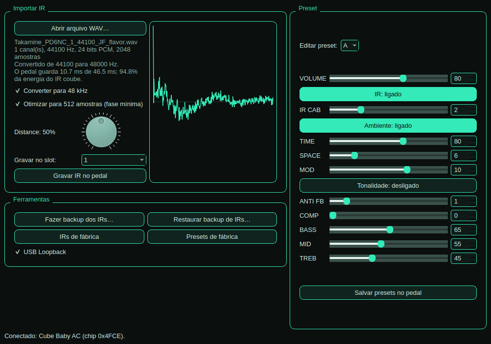

# Cube Baby Editor 🎸🐧

**Editor nativo para Linux do pedal Cube Baby AC (Cuvave / M-VAVE)** — edite presets, importe IRs e
use o pedal como placa de som, **sem Windows e sem Wine**.

🇺🇸 [Read in English](README.md)



---

> ## ⚠️ Leia antes de tudo
>
> **Eu não sou programador e não sou técnico de áudio** — entendo pouquíssimo dessa área.
> **Todo o código, a engenharia reversa do protocolo, os testes, o empacotamento e esta
> documentação foram gerados pelo Claude** (inteligência artificial da Anthropic), usando o
> Claude Code, a partir das minhas instruções e dos testes que fiz com o meu próprio pedal.
>
> Eu publiquei porque funcionou para mim e pode ajudar outras pessoas que, como eu, usam Linux e
> tinham um pedal que "só funcionava no Windows". Não tenho como dar suporte técnico avançado.

> **Aviso legal:** projeto independente, feito para **interoperabilidade** (fazer o seu próprio
> aparelho funcionar no seu sistema). **Não é afiliado, endossado ou suportado pela Cuvave /
> M-VAVE.** Cube Baby, Cuvave e M-VAVE são marcas dos seus donos. Nenhum arquivo, código ou
> firmware da Cuvave é distribuído aqui. **Use por sua conta e risco** — o software é fornecido
> "como está", sem garantias (veja a [licença](LICENSE)).

---

## Sumário

- [O que é](#o-que-é)
- [✨ O que fizemos melhor que o programa original](#-o-que-fizemos-melhor-que-o-programa-original)
- [Funções](#funções)
- [Compatibilidade](#compatibilidade)
- [Instalação rápida (.deb)](#instalação-rápida-deb)
- [Primeiro uso](#primeiro-uso)
- [Usar o pedal como placa de som](#usar-o-pedal-como-placa-de-som)
- [Guia de cada função do pedal](#guia-de-cada-função-do-pedal)
- [Importar IRs](#importar-irs)
- [Backups e IRs de fábrica](#backups-e-irs-de-fábrica)
- [E o firmware?](#e-o-firmware)
- [Problemas comuns](#problemas-comuns)
- [Instalar a partir do código (outras distribuições)](#instalar-a-partir-do-código-outras-distribuições)
- [Instalação feita por outra IA](#instalação-feita-por-outra-ia)
- [Como o projeto foi feito](#como-o-projeto-foi-feito)
- [Como contribuir](#como-contribuir)
- [Licença](#licença)

---

## O que é

O Cube Baby AC é um pequeno processador de efeitos para violão. O fabricante oferece um programa
para configurá-lo, o **CubeSuite**, que só existe para Windows. No Linux ele até roda no Wine, mas
de forma improvisada.

O **Cube Baby Editor** substitui o CubeSuite com um programa **nativo para Linux**, instalado como
qualquer outro (`.deb`), que conversa direto com o pedal pelo USB.

## ✨ O que fizemos melhor que o programa original

Não quisemos só "copiar" o CubeSuite para o Linux. Ao estudar como ele funciona por dentro,
encontramos limitações e resolvemos várias delas. Tudo abaixo foi comprovado pela análise do código
do CubeSuite ou por medição:

| | CubeSuite (fabricante) | Cube Baby Editor (este projeto) |
|---|---|---|
| **Sistema** | Só Windows (no Linux, só improvisado com Wine) | **Nativo para Linux**, instala com `.deb` e atualiza junto com o sistema |
| **IR em 44,1 kHz** (formato mais comum) | Grava sem converter: o IR fica ~9% mais curto e o timbre muda (~1,5 semitom acima) | **Converte para 48 kHz**: o IR soa como foi gravado |
| **IRs maiores que o limite do pedal** (512 amostras) | Corta seco e pronto | **Otimização por fase mínima** antes do corte: **~14% menos erro de timbre e ~32% menos nos graves** (medido num IR real de violão) |
| **Quanto do IR cabe no pedal** | Não informa | **Mostra** a duração guardada e a % da energia do IR que coube, com prévia da forma de onda já processada |
| **WAV de 32 bits** | Mono (float ou PCM): lê só metade de cada amostra, como se fosse 16 bits, e o IR sai errado. PCM estéreo: não lê nada (IR zerado) | **Lidos corretamente**, assim como PCM 16/24 bits e o formato *extensible* |
| **Backup antes de gravar um IR** | Não faz | **Automático**, sempre, antes de qualquer substituição |
| **Backup inicial do pedal** | Não existe | **Automático na primeira conexão** (8 IRs + 3 presets) |
| **"IRs de fábrica"** | Apaga os seus IRs personalizados sem guardar cópia | **Faz backup completo antes** e permite voltar atrás |
| **Restaurar IRs** | Não existe | Restaura **todos** ou **um slot só** |
| **Proteção do firmware** | Sem trava no editor | **Trava de segurança:** recusa apagar/gravar qualquer área da memória fora dos IRs |
| **USB Loopback** | Reenvia o estado ao abrir o editor | **Lê o estado real do pedal** e mostra |
| **Internet** | Baixa firmware por HTTP sem criptografia, direto de um IP | **Não acessa a internet** |
| **Código e documentação** | Fechados | **Código aberto (MIT)**, protocolo documentado e testes automáticos conferidos contra mensagens reais do pedal |

## Funções

| Função | Situação |
|---|---|
| Ler os presets A, B e C do pedal | ✅ |
| Alterar todos os controles **ao vivo** (ouve na hora) | ✅ |
| Ligar/desligar cada seção (IR, Ambiente, Tonalidade) | ✅ |
| Salvar os presets no pedal (com conferência) | ✅ |
| Voltar os presets aos valores de fábrica | ✅ |
| USB Loopback (ligar/desligar, mostra o estado real) | ✅ |
| Importar IR a partir de WAV (16/24/32 bits, mono ou estéreo) | ✅ |
| **Converter o IR para 48 kHz** automaticamente | ✅ (o CubeSuite não faz) |
| **Otimizar o IR para o limite de 512 amostras** (fase mínima) | ✅ (o CubeSuite não faz) |
| Backup e restauração de IRs (todos ou um slot) | ✅ (o CubeSuite não faz) |
| Backup automático na primeira conexão | ✅ (o CubeSuite não faz) |
| Restaurar os IRs de fábrica | ✅ (precisa de um arquivo do CubeSuite — [veja aqui](#backups-e-irs-de-fábrica)) |
| Usar como placa de som (gravar/tocar) | ✅ funciona sem nenhum programa |
| Atualizar o firmware | ❌ de propósito — [veja por quê](#e-o-firmware) |

**Segurança:** o firmware do pedal fica na mesma memória que os IRs. O programa **se recusa a
apagar ou gravar qualquer coisa fora da área dos IRs** e sempre faz backup antes de substituir um IR.

## Compatibilidade

**Pedal:** somente o **Cube Baby AC** foi testado (ID USB `301a:5555`). Se outro modelo for
conectado, o programa avisa e não faz nada.

**Sistemas (pacote .deb):**

| Sistema | Situação |
|---|---|
| Zorin OS 18 | ✅ testado |
| Ubuntu 24.04 ou mais novo, Linux Mint 22, Pop!_OS 24.04 | ✅ deve funcionar (mesma base) |
| Debian 12 ou mais novo | ✅ deve funcionar |
| Ubuntu 22.04 / Mint 21 e anteriores | ❌ não têm o PyQt6 nos repositórios — use [a instalação pelo código](#instalar-a-partir-do-código-outras-distribuições) |
| Fedora, Arch e outras | ⚙️ [a partir do código](#instalar-a-partir-do-código-outras-distribuições) (não testado) |

## Instalação rápida (.deb)

1. Baixe o arquivo `cubebaby-editor_X.Y.Z_all.deb` na página de
   [**Releases**](../../releases/latest) deste repositório.
2. Abra o terminal na pasta onde ele foi salvo (normalmente `Downloads`) e rode:

   ```bash
   cd ~/Downloads
   sudo apt update
   sudo apt install ./cubebaby-editor_*_all.deb
   ```

   > O `./` na frente do nome é importante: ele diz ao `apt` que é um arquivo local. O `apt`
   > instala sozinho tudo o que o programa precisa (PyQt6, python3-rtmidi, numpy, scipy).
   > Um aviso do tipo *"Download is performed unsandboxed as root"* é normal e pode ser ignorado.

3. Abra o **Cube Baby Editor** pelo menu de aplicativos (ou digite `cubebaby-editor` no terminal).

**Só isso.** Não é preciso instalar driver: o Linux já reconhece o pedal.

**Atualizar:** baixe o `.deb` novo e repita o passo 2.
**Desinstalar:** `sudo apt remove cubebaby-editor`
(seus backups em `~/.local/share/cubebaby-editor/` não são apagados).

## Primeiro uso

1. Ligue o pedal e conecte-o ao computador pelo cabo USB.
2. **Feche o CubeSuite/Wine**, se estiver aberto — dois programas falando com o pedal ao mesmo
   tempo se atrapalham.
3. Abra o Cube Baby Editor. Na barra de baixo deve aparecer
   `Conectado: Cube Baby AC (chip 0x4FCE)`.
4. Na **primeira conexão**, o programa faz automaticamente um **backup dos 8 IRs e dos 3 presets**
   que estão no pedal (leva uns 15 segundos). Se você nunca mexeu nos IRs, esse backup **são os IRs
   de fábrica** — guarde bem.

Os backups ficam em `~/.local/share/cubebaby-editor/backups/` (é uma pasta oculta: no gerenciador de
arquivos, aperte `Ctrl+H` para ver).

## Usar o pedal como placa de som

Isso **não depende deste programa**: o pedal segue o padrão *USB Audio Class* e o Linux o reconhece
sozinho.

- Ele aparece como **"USB2.0 Device"** nas configurações de som.
- **Entrada (gravar):** 1 canal, 48 kHz, 16 bits. **Saída:** 2 canais, 48 kHz, 16 bits.
- Escolha **"USB2.0 Device"** como entrada no Audacity, Reaper, Ardour, OBS, etc.

Teste rápido no terminal (toque algo enquanto grava 5 segundos):

```bash
arecord -l                      # descubra o número da placa "USB2.0 Device" (ex.: card 2)
arecord -D plughw:2,0 -f S16_LE -r 48000 -c 1 -d 5 teste.wav && aplay teste.wav
```

## Guia de cada função do pedal

> Não há manual oficial detalhado do Cube Baby AC disponível. O que segue junta o que o código do
> CubeSuite revela com a descrição do fabricante. **Onde é dedução, está indicado.** Na dúvida,
> mexa em um controle por vez e ouça.

### Presets

- **A, B e C** — três "memórias" com todos os ajustes. Você troca entre elas no próprio pedal. No
  programa, o seletor A/B/C só escolhe **qual** delas você está editando.
- **Ao vivo × salvo** — mexer num controle muda o som **na hora**, mas isso só fica gravado de
  verdade quando você clica em **"Salvar presets no pedal"** (o botão mostra um `*` quando há
  alterações não salvas). Sem salvar, o pedal volta ao que estava quando for desligado.

### Controles

| Controle | Faixa | O que faz |
|---|---|---|
| **VOLUME** | 0–127 | Volume geral do preset. |
| **IR CAB** | 0–8 | Qual dos 8 IRs (simulações de corpo de violão) o preset usa. O valor N usa o slot N. *Dedução:* 0 provavelmente = nenhum IR. |
| **TIME** | 0–127 | *Dedução:* efeito de tempo — delay (eco). |
| **SPACE** | 0–31 | *Dedução:* ambiência — reverb. |
| **MOD** | 0–15 | *Dedução:* modulação — chorus/tremolo. |
| **ANTI FB** | 0–8 | **Antimicrofonia.** O fabricante descreve "até 8 filtros automáticos" contra microfonia ao vivo; o número parece ser quantos filtros ficam ativos. Use mais quando tocar alto, perto da caixa. |
| **COMP** | 0–8 | **Compressor.** Iguala notas fortes e fracas; quanto maior, mais uniforme (e menos dinâmico). |
| **BASS / MID / TREB** | 0–127 | Equalizador: graves, médios e agudos. |

### Botões de seção

Ligam/desligam uma seção inteira sem perder os ajustes dela:

- **IR** → controla o IR CAB
- **Ambiente** → TIME, SPACE e MOD
- **Tonalidade** → ANTI FB, COMP, BASS, MID e TREB

### Ferramentas

- **USB Loopback** — quando o pedal está ligado ao PC como placa de som, o loopback **mistura o som
  que o computador está tocando dentro do sinal que o pedal grava.**
  - **Ligado:** ideal para **lives/streaming** — tocar junto com um playback e mandar os dois para o
    OBS, Zoom, etc.
  - **Desligado:** use para **gravar num programa de áudio** (Reaper, Audacity…). Ligado, o
    programa regravaria o que ele mesmo está tocando (eco/faixas duplicadas).
- **Presets de fábrica** — volta A, B e C aos valores originais. Os IRs não são alterados.
- **IRs de fábrica**, **Fazer backup dos IRs**, **Restaurar backup** — veja
  [Backups e IRs de fábrica](#backups-e-irs-de-fábrica).

## Importar IRs

Um **IR** (*impulse response*) é uma "impressão digital" do som de um violão/caixa. O pedal tem
**8 espaços (slots)** para IRs, escolhidos pelo controle **IR CAB**.

1. Clique em **"Abrir arquivo WAV…"** e escolha o IR.
2. Confira as informações e a forma de onda na prévia.
3. Ajuste o **Distance** e escolha o **slot** em "Gravar no slot".
4. Clique em **"Gravar IR no pedal"**. O IR anterior daquele slot é salvo antes, automaticamente.
5. Coloque o **IR CAB** no número do slot e ouça.

**Formatos aceitos:** WAV PCM 16, 24 ou 32 bits, ou float 32 bits; mono ou estéreo (usa o primeiro
canal).

### As duas opções de qualidade (ligadas por padrão)

- **Converter para 48 kHz** — o pedal trabalha a 48 kHz. Muitos IRs vêm em 44,1 kHz; sem conversão
  (como o CubeSuite faz) o IR fica ~9% "mais curto" e as ressonâncias sobem de frequência (~1,5
  semitom), mudando o timbre.
- **Otimizar para 512 amostras (fase mínima)** — o pedal só guarda **512 amostras** por IR (~10,7 ms;
  é limite do aparelho, não do programa). IRs maiores são cortados. Esta opção reorganiza o IR para
  concentrar a energia no começo, então o corte perde menos. Num IR de violão real de 2048 amostras,
  o erro de timbre caiu ~14% no geral e **~32% nos graves**. Ela muda um pouco o comportamento do
  ataque — compare de ouvido, ligando e desligando.

O programa mostra quanto do IR coube (por exemplo: *"O pedal guarda 10.7 ms de 46.5 ms; 94.8% da
energia do IR coube"*).

### Distance

É um valor (0–100%) gravado **junto com cada IR**. Os IRs de fábrica usam entre 52% e 80%. Como o
pedal usa esse número fica dentro do firmware e **não é conhecido**; pelo nome, provavelmente simula
a distância do microfone (perto = mais encorpado, longe = mais "ar"/sala). **Teste:** grave o mesmo
IR com 10% e com 90% e compare.

## Backups e IRs de fábrica

Tudo fica em `~/.local/share/cubebaby-editor/` (pasta oculta — inclua-a nos seus backups):

| Arquivo | O que é |
|---|---|
| `backups/irs-primeira-conexao-*.bin` | os 8 IRs que estavam no pedal na primeira conexão |
| `backups/presets-primeira-conexao-*.bin` | os 3 presets da primeira conexão |
| `backups/irs-slot4-*.bin` | backup automático de um slot, feito antes de gravar um IR nele |
| `backups/irs-completo-*.bin` | backup automático antes de restaurar/regravar os 8 IRs |
| `factory/BCIF.bin` | IRs de fábrica (cópia do arquivo do CubeSuite) |

- **"Restaurar backup de IRs…"** aceita backups **completos** (32 KB, os 8 IRs) e de **um slot só**
  (4 KB — o slot é identificado pelo nome do arquivo).
- **"IRs de fábrica"** precisa do arquivo `BCIF.bin`, que vem dentro do CubeSuite oficial e
  **não pode ser distribuído aqui** (é da Cuvave). Na primeira vez o programa pede para você
  localizá-lo e guarda uma cópia; depois não precisa mais do CubeSuite.
  - Como conseguir: baixe o CubeSuite no **site oficial da M-VAVE**, descompacte e procure
    `bin/BCIF.bin`. Não é preciso instalar nem rodar o CubeSuite.
  - **Alternativa sem o CubeSuite:** o backup da primeira conexão (se você nunca tinha trocado IRs).

## E o firmware?

O firmware é o programa interno do pedal. **Para usar o pedal no dia a dia, não é preciso mexer
nele** — todas as funções do editor funcionam sem isso. Este projeto **não atualiza firmware, de
propósito**:

- Um erro na gravação do firmware pode deixar o pedal **inutilizável**, e não se sabe se ele tem modo
  de recuperação.
- O firmware que vem junto com o CubeSuite (`cubebaby_A_20220706.up`) é do **Cube Baby comum, não do
  AC** — o próprio fabricante avisa que firmware errado faz o pedal parar de funcionar.
- O CubeSuite baixa firmwares por HTTP sem criptografia.

Se a Cuvave lançar um firmware novo para o AC que seja realmente necessário, a recomendação é
fazer a atualização com o CubeSuite oficial (no Windows ou no Wine).

## Problemas comuns

| Sintoma | Solução |
|---|---|
| "Pedal não encontrado. Ele está conectado no USB?" | Confira o cabo (alguns cabos só carregam, não transmitem dados) e se o pedal está ligado. Rode `amidi -l`: deve aparecer `USB2.0 Device MIDI 1`. |
| Conecta e logo perde a conexão / "Sem resposta do pedal" | Feche o CubeSuite/Wine e qualquer outro programa MIDI que esteja usando o pedal. Desconecte e reconecte o cabo. |
| O programa não abre; erro sobre `xcb` ou `xcb-cursor` | `sudo apt install libxcb-cursor0` |
| `apt` diz que `python3-pyqt6` não existe | Seu sistema é antigo demais para o `.deb` (ex.: Ubuntu 22.04). Use [a instalação pelo código](#instalar-a-partir-do-código-outras-distribuições). |
| "Modelo não suportado (id 0x…)" | Seu pedal não é um Cube Baby AC. O programa não arrisca gravar nele. Veja [Como contribuir](#como-contribuir). |
| "A verificação falhou" ao gravar | Nada foi perdido: o backup do que estava no slot foi feito antes. Tente de novo; se repetir, troque o cabo/porta USB. |
| O som do IR ficou estranho | Teste com as opções "Converter para 48 kHz" e "Fase mínima" ligadas/desligadas e outro valor de Distance. |

Para ver mensagens detalhadas, abra pelo terminal: `cubebaby-editor`.

## Instalar a partir do código (outras distribuições)

Precisa de **Python 3.10+** e das bibliotecas **PyQt6** (ou PySide6), **python-rtmidi**, **numpy** e
**scipy**.

```bash
git clone https://github.com/walbertfreitas/cubebaby-editor.git
cd cubebaby-editor
```

**Opção A — bibliotecas do sistema:**

```bash
# Debian / Ubuntu / Zorin / Mint
sudo apt install python3-pyqt6 python3-rtmidi python3-numpy python3-scipy libxcb-cursor0
# Fedora (não testado)
sudo dnf install python3-pyqt6 python3-rtmidi python3-numpy python3-scipy xcb-util-cursor
# Arch / Manjaro (não testado)
sudo pacman -S python-pyqt6 python-rtmidi python-numpy python-scipy xcb-util-cursor

python3 -m cubebaby
```

**Opção B — ambiente virtual (qualquer distribuição):**

```bash
sudo apt install python3-venv libasound2-dev libxcb-cursor0   # equivalentes na sua distro
python3 -m venv .venv
.venv/bin/pip install PyQt6 python-rtmidi numpy scipy
.venv/bin/python -m cubebaby
```

**Gerar o seu próprio `.deb`:** `packaging/build-deb.sh` → o pacote sai em `dist/`.

**Rodar os testes:** `python3 -m unittest discover -s tests -v`

## Instalação feita por outra IA

Se você usa um assistente de IA com acesso ao terminal (Claude Code, Codex, Gemini CLI, etc.), peça
para ele seguir o arquivo **[`docs/AI-INSTALL.md`](docs/AI-INSTALL.md)**. É um roteiro passo a
passo, com verificações e cuidados de segurança, escrito para ser seguido por uma IA. Por exemplo:

> *"Leia https://github.com/walbertfreitas/cubebaby-editor/blob/main/docs/AI-INSTALL.md e instale o Cube Baby
> Editor no meu computador seguindo exatamente essas instruções."*

## Como o projeto foi feito

Resumo para curiosos (detalhes técnicos em **[`docs/PROTOCOL.md`](docs/PROTOCOL.md)**, em inglês):

1. Descobriu-se que o pedal é *USB Audio/MIDI class compliant* — o áudio já funcionava no Linux.
2. O tráfego USB entre o CubeSuite (rodando no Wine) e o pedal foi gravado com `usbmon`/Wireshark
   enquanto cada controle era alterado, um por vez.
3. O executável do CubeSuite foi analisado com o **Ghidra** (via o servidor MCP
   [REA](https://github.com/morluto/rea)) para entender o formato das mensagens (SysEx compactado em
   7 bits), os comandos de leitura/gravação de memória, o mapa dos presets, o formato dos IRs e as
   áreas perigosas da memória.
4. O protocolo foi reimplementado em Python e testado contra mensagens reais gravadas.

Tudo isso foi feito pelo Claude (Anthropic), conduzido por mim, para interoperabilidade com o meu
próprio aparelho.

## Como contribuir

- **Tem outro modelo da linha Cube** (Cube Baby comum, Bass, Sugar, Magic…)? O transporte é o mesmo,
  mas o mapa de memória muda. Abra uma *issue* com o modelo e o ID USB (`lsusb`) — capturas de
  tráfego do CubeSuite ajudam muito (veja `tools/`).
- **Sabe exatamente o que TIME, SPACE, MOD ou Distance fazem?** Abra uma *issue* — vamos corrigir o
  guia.
- *Pull requests* são bem-vindos; rode os testes antes.

## Licença

[MIT](LICENSE) — use, modifique e distribua livremente, sem garantias.
